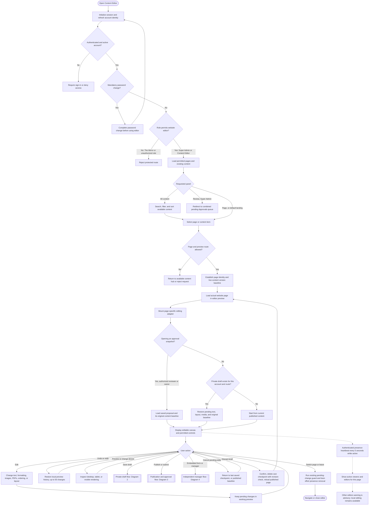
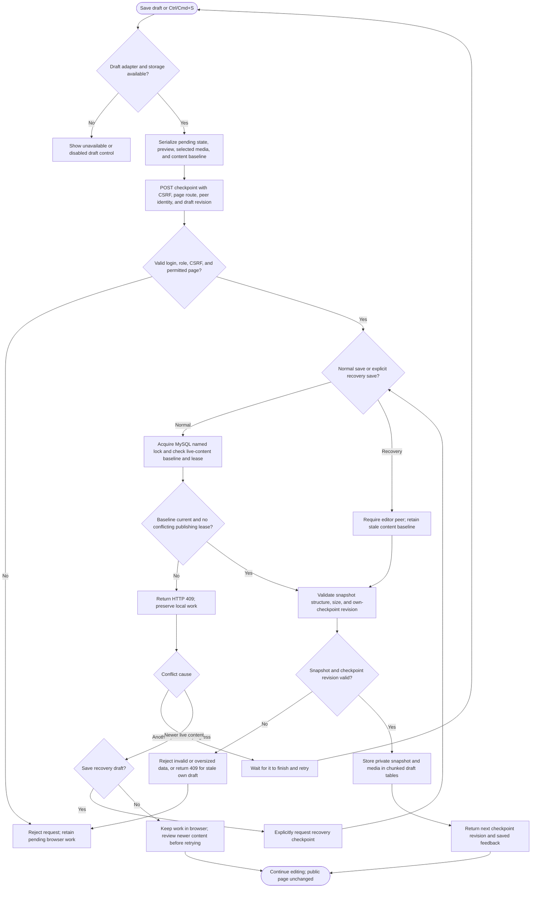
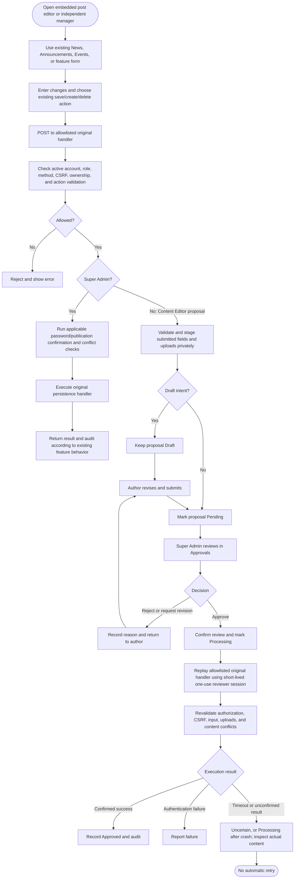

# Content Editor module — detailed flowchart

These diagrams describe the current repository implementation, including the visual editor, private checkpoints, publication, approval, and conflict handling. They document existing behavior; they do not introduce a new workflow. Open this file in a Markdown preview that supports Mermaid.

## 1. Access, page selection, and editing

Content comes from existing database-backed page sections and feature tables, not a separate hardcoded preview. The editor uses different adapters for homepage content, section pages, administration, departments/programs, student life, admissions/PDFs, and other supported pages. News, announcements, and events reuse their existing editors.

Both Super Admin and Content Editor currently receive `manage_page_content` in the permission map. Direct publication is additionally restricted by the role-aware submission boundary; that permission alone does not mean a Content Editor can publish directly.

## 2. Private draft, validation, and conflict recovery

- Checkpoints are scoped to the signed-in account and page/subpage route. There is no automatic save.
- Incomplete content can be saved privately. Draft media stays encoded in private checkpoint storage until the normal upload/publish handlers process it.
- A recovery draft preserves work but retains its stale baseline. It cannot override a newer publication. Reopen current content, reconcile changes, and then save or resubmit.
- Live-content version checks and same-account checkpoint revision checks solve different conflicts. Neither provides automatic merging.
- Draft storage uses `content_editor_drafts` and `content_editor_draft_chunks`; presence/version protection requires its separate metadata tables. Missing protection storage prevents visual-editor saves.

## 3. Submission, review, and direct publication

```mermaid
flowchart TD
    A([Choose primary action]) --> B{Content Editor or Super Admin?}
    B -->|Content Editor| C[Confirm Submit for approval]
    C --> D{Confirmed?}
    D -->|No| E([Continue editing])
    D -->|Yes| F[Save current private checkpoint using Diagram 2]
    F --> G{Checkpoint saved successfully?}
    G -->|No| H[Show error; retain working changes]
    H --> E
    G -->|Yes| I[Submit checkpoint revision for review]
    I --> J[Recheck authorization, CSRF, content baseline, and checkpoint revision]
    J --> K{Checks pass?}
    K -->|No| H
    K -->|Yes| L[Store pending whole-page snapshot in approval submission storage]
    L --> M[Author tracks status in My Submissions; live content unchanged]
    M --> N[Super Admin opens pending submission in Approvals]
    N --> O[Inspect proposed text, media, and saved canvas]
    O --> P{Review decision}
    P -->|Reject or request revision| Q[Record reason or feedback and review status]
    Q --> R[Author revises saved proposal and resubmits]
    R --> C
    P -->|Approve and publish snapshot| S[Open authorized saved snapshot with original baseline]
    S --> T[Run existing page publication workflow]
    B -->|Super Admin direct publication| T

    T --> U[Inspect content completeness]
    U --> V{Missing authored text or media?}
    V -->|Yes| W{Completeness warning decision}
    W -->|Keep Editing| E
    W -->|Publish Anyway| X[Set allow_incomplete for this operation]
    V -->|No| Y{Confirm publication?}
    Y -->|Keep editing| E
    Y -->|Publish changes| Z[Request current Super Admin password]
    X --> Z
    Z --> AA{Password confirmation valid?}
    AA -->|Incorrect| AB[Show error; allow retry under rate limits]
    AB --> Z
    AA -->|Cancelled| E
    AA -->|Yes| AC[Issue short-lived publication confirmation token]
    AC --> AD[Send placement, background, media, and adapter-specific save requests]
    AD --> AE[Server rechecks identity, authorization, CSRF, token, and input validity]
    AE --> AF[Serialize guarded writes; verify saved baseline and publishing lease]
    AF --> AG{Request valid and version current?}
    AG -->|No| AH[Reject write; report validation, permission, or conflict error]
    AG -->|Yes| AI[Reserve content revision; execute existing feature handler]
    AI --> AJ{All required writes complete?}
    AJ -->|More requests| AD
    AJ -->|Failure or partial completion| AH
    AH --> AK[Retain remaining work; some earlier requests may already be committed]
    AK --> AL[Release lease and confirmation; clear operation flags]
    AL --> E
    AJ -->|Success| AM{Publishing a reviewed snapshot?}
    AM -->|Yes| AN[Complete pending approval and record approval/publication activity]
    AM -->|No| AO[Record page publication summary for Recent Content where applicable]
    AN --> AO
    AO --> AP[Clear completed private checkpoint and refresh preview as needed]
    AP --> AQ[Release lease and confirmation; clear incomplete-content override]
    AQ --> AR([Published content available to visitors])
```

The completeness warning can permit missing authored content; it does not bypass URL/type/length validation, upload safety, authentication, authorization, CSRF, publication confirmation, record integrity, or conflict protection. A stale proposal must be reviewed and resubmitted against current content before approval can succeed.

Publishing can use several requests. Existing per-handler transactions remain in place, but the complete page operation is not one database transaction. Partial success can change live content even if a later request fails. Successful writes establish a new local history baseline; Undo cannot reverse a committed server action. Approval/history recording errors must also be inspected separately from whether content writes already succeeded.

## 4. Embedded forms and independent managers

These forms retain their existing behavior. Save Draft in the visual canvas does not stage or undo independent manager actions that have already committed. Pending form proposals and whole-page snapshot submissions are distinct from private visual-editor checkpoints. Legacy page-text review also remains supported: reviewers compare current/proposed sections, approve with confirmation or request changes, and section-version checks prevent stale decisions.

## Implementation references

| Responsibility | Source |
| --- | --- |
| Editor entry, permitted panels, real-page preview, configuration | [`admin/content-edit.php`](../admin/content-edit.php) |
| Permission map and section content functions | [`admin/admin-functions.php`](../admin/admin-functions.php) |
| Role-aware route boundary | [`includes/admin-rbac.php`](../includes/admin-rbac.php) |
| Canvas adapters, confirmation, publish lifecycle | [`assets/js/content-edit.js`](../assets/js/content-edit.js) |
| Private draft save/restore/submit | [`assets/js/editor-drafts.js`](../assets/js/editor-drafts.js), [`admin/action/editor-draft-handler.php`](../admin/action/editor-draft-handler.php), [`includes/content-editor-drafts.php`](../includes/content-editor-drafts.php) |
| Presence, versions, locks, leases | [`includes/editor-presence.php`](../includes/editor-presence.php), [`assets/js/editor-presence.js`](../assets/js/editor-presence.js) |
| Local undo/redo | [`assets/js/editor-history.js`](../assets/js/editor-history.js) |
| Password-confirmed publishing | [`assets/js/admin-publish-confirmation.js`](../assets/js/admin-publish-confirmation.js), [`includes/publish-confirmation.php`](../includes/publish-confirmation.php) |
| Completeness policy | [`includes/content-publish-policy.php`](../includes/content-publish-policy.php) |
| Proposal storage/replay and review presentation | [`includes/content-submissions.php`](../includes/content-submissions.php), [`admin/approval-view.php`](../admin/approval-view.php) |

Related documentation: [drafts](content-editor-drafts.md), [publishing](content-editor-publishing.md), [presence/conflicts](content-editor-presence.md), [undo/redo](content-editor-history.md), and [roles/approvals](admin-access-and-approvals.md).

Verification: traced against the source files and existing workflow documentation. These are documentation diagrams, not evidence of an end-to-end runtime test. No application code, database records, or configuration were changed.
